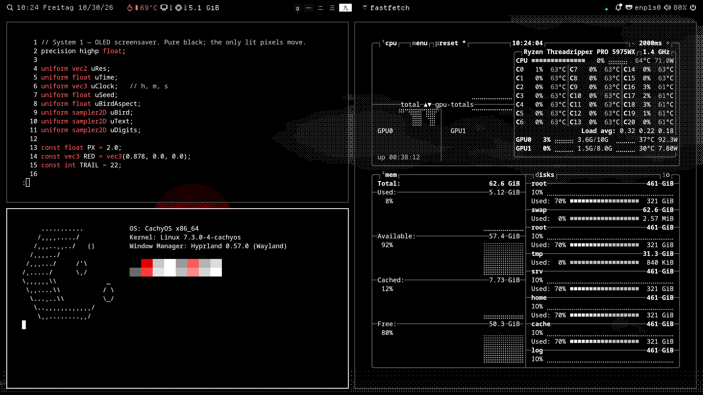
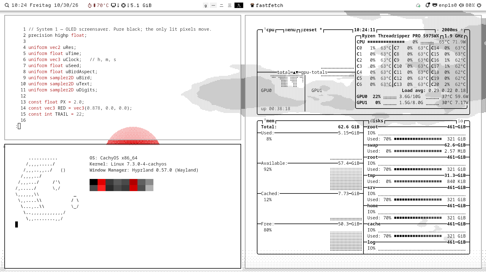
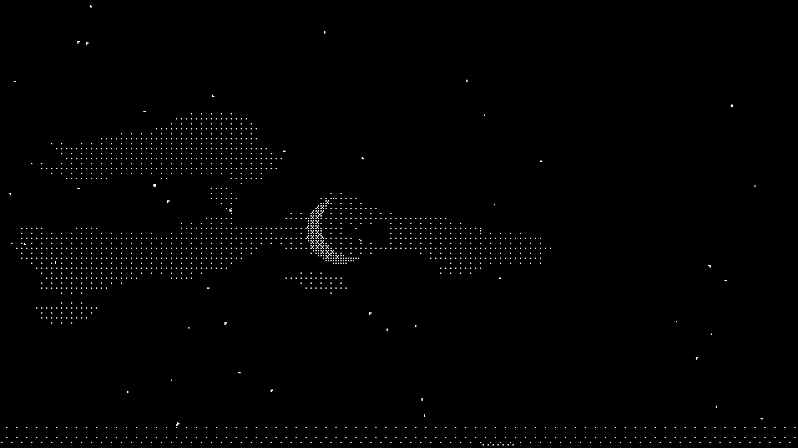
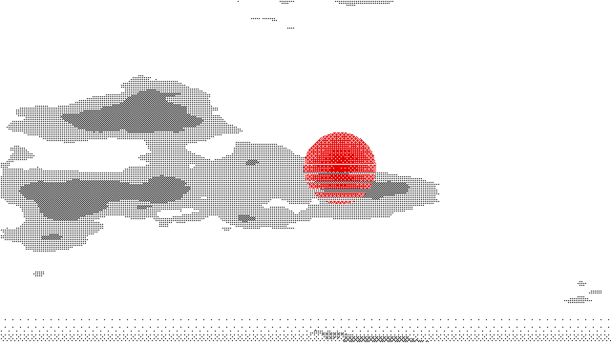
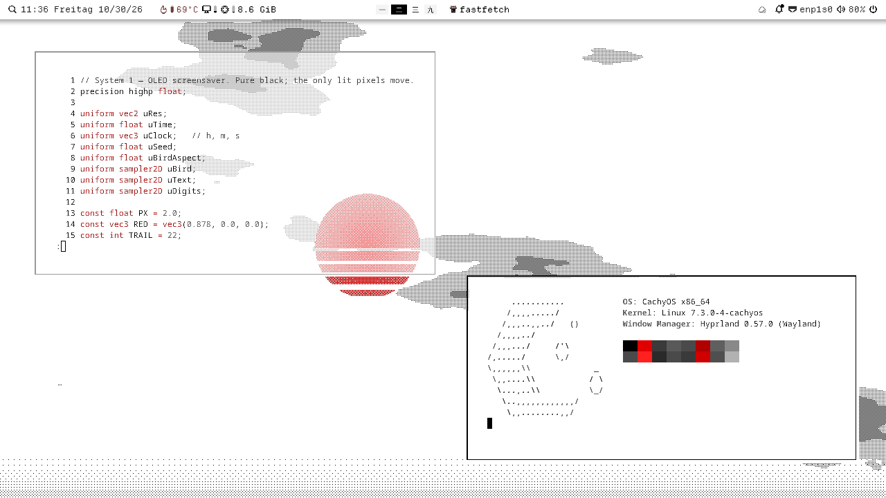
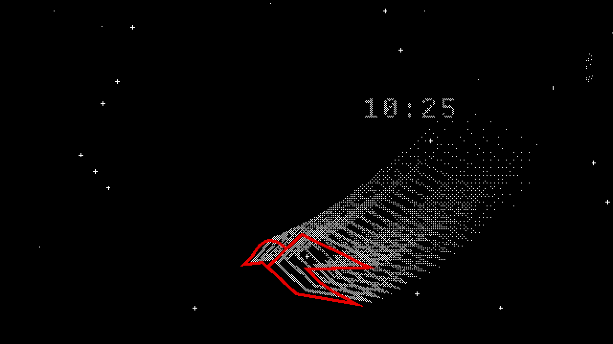

# System 1

A Hyprland + Noctalia desktop theme after the 1984 Macintosh, by way of
[futc.de](https://futc.de): 1-bit black and white, one red, a paper bird and
a little Japanese. Light by day, dark after sunset, built for OLED screens.




*Dark and light mode. Light/dark follows the sun on its own.*

| Night | Day |
|-------|-----|
|  |  |

*The animated background, sped up about 20×: clouds drift, stars twinkle one
at a time, and every two minutes a caption fades in with the bird and the seal.*



*At work, as a time-lapse (about 15×): behind the windows the sky drifts and
captions come and go, showing through the inactive window.*



*The screensaver (3× speed): pure black, the red bird and its trail, a
drifting clock.*

More in [`docs/screenshots/`](docs/screenshots/).

## What it does

- **Windows**: square corners, 2 px borders and a hard offset drop shadow on
  the focused window. No blur. Inactive windows are slightly see-through.
- **Red only flashes**: the border flashes red for 0.2 s when focus changes;
  hover, selection and errors are red; nothing stays red on screen.
- **Animated background**: a slow, dithered sky with banded clouds, a
  striped retro sun, then a moon and wheeling stars at night. Every two minutes a
  vertical Japanese caption fades in and out, with the small red bird above
  it and a red 鳥 seal below (おはよう, こんにちは, 夕焼け, おやすみ by time of day). Sun
  and moon follow your real sunrise and sunset. The whole frame orbits a few
  pixels so nothing sits still on an OLED.
- **Light and dark**: follow the sun (Noctalia `mode = "auto"`), with an
  ordered-dither dissolve between them.
- **Screensaver**: after 3 minutes idle, near-total black with the red bird
  trailing white ghosts and a drifting Departure Mono clock. Screens turn off after 10.
- **Bar and shell**: Noctalia gets the palette, Departure Mono, square
  panels, pixelated icons and kanji workspace numbers (一 二 三 …). Through
  Noctalia's templates, kitty, Alacritty, GTK, Qt and btop follow along.
- **Easy to leave**: `theme-switch off` puts back the Hyprland theme,
  palette, mode, wallpapers and idle timeout you had before.

## Requirements

- Hyprland 0.56 or newer with the **Lua** config (`~/.config/hypr/hyprland.lua`)
- [Noctalia](https://noctalia.dev) 5.4 or newer as the shell
- To build: a C compiler, `make`, `pkg-config`, `wayland-scanner`, and the
  wayland-client, wayland-egl, EGL and GLESv2 headers
- `rsvg-convert` (librsvg), ImageMagick 7 (`magick`), `curl`, and Python 3
  with Pillow and fontTools

On Arch-based systems:

    sudo pacman -S --needed base-devel wayland mesa librsvg imagemagick python-pillow python-fonttools curl

Developed on CachyOS with an NVIDIA GPU, a 3440×1440 OLED and a portrait
1440p monitor.

## Install

    git clone https://github.com/FUTC-Coding/SYSTEM-1 ~/Projects/system1
    cd ~/Projects/system1
    ./install.sh --location "50.78 6.08"      # your latitude and longitude

The installer links the checkout to `~/.config/system1`, downloads the two
fonts (OFL) if you don't have them, builds the renderer, renders the
textures and pixel icons, and links the Hyprland files into
`~/.config/hypr/themes/`. If your `hyprland.lua` doesn't load the theme
loader yet, it tells you to add this line **after** your own look settings:

```lua
require("themes.loader")
```

Then reload Hyprland and switch it on:

    ~/.config/system1/bin/theme-switch system1

Run `./install.sh` again after a `git pull` or a Noctalia update.

### Your existing look

The loader reads `~/.config/hypr/theme-name`. For any name other than
`system1` it loads `~/.config/hypr/themes/<name>/init.lua` if that exists,
and otherwise loads nothing and leaves your config alone. So you can either
keep your decorations in `hyprland.lua` (the loader only adds System 1 on
top while it's active), or move them into `themes/<name>/init.lua` and put
that name in `theme-name`. `theme-switch` remembers which one was active and
restores it.

## Use

    theme-switch system1 | off | toggle | status

| Keys            | Does                                                       |
|-----------------|------------------------------------------------------------|
| SUPER+CTRL+T    | switch System 1 on/off                                     |
| SUPER+CTRL+S    | screensaver now (any input closes it)                      |
| SUPER+CTRL+B    | pause/resume the animated background                       |
| SUPER+CTRL+M    | flip light/dark by hand (`noctalia msg theme-mode-set auto` follows the sun again) |

Switching restarts Noctalia for a second (it loads its icon font only at
startup) and reloads Hyprland.

## Make it yours

- **Location**: `./install.sh --location "LAT LON"`, or edit `location`.
- **Logo**: replace `logo/bird.svg` (any SVG; its alpha is used) and run
  `src/build-assets.sh`.
- **Phrases**: edit `PHRASES` in `src/build-assets.sh` and keep
  `phraseLen()` in `shaders/background.frag` in step with their lengths.
- **The scenes**: `shaders/background.frag` and `shaders/saver.frag`. Edit,
  then `pkill -HUP -fx ~/.config/system1/bin/system1-bg` to reload them.
- **Frame rate**: `SYSTEM1_FPS` (default 15). The background costs a few
  watts of GPU on NVIDIA mostly by keeping the GPU awake, not by the shader.
- **Idle timers**: the saver's timeout is in `noctalia/system1.toml`, the
  screen-off timeout is `SAVER_SCREEN_OFF` in `bin/theme-switch`.
- **Colours**: `noctalia/System1.json` (Noctalia palette, dark and light)
  and `PALETTE` in `hypr/system1.lua`.

## How it fits together

| Path                          | What                                                        |
|-------------------------------|-------------------------------------------------------------|
| `src/system1-bg.c`            | wlr-layer-shell + GLES2 renderer, one surface per output: the background, the screensaver (`--saver`) and still renders (`--snapshot W H dark\|light HOUR out.ppm`) |
| `shaders/`                    | the animated background and the screensaver                 |
| `src/build-assets.sh`         | bird, captions and clock digits as PGM textures in `assets/` |
| `src/pixel-icons.py`          | resamples Noctalia's Tabler icon font onto a 16×16 grid into `noctalia/assets/` (used through `NOCTALIA_ASSETS_DIR`) |
| `hypr/loader.lua`             | picks the Hyprland theme, kanji workspace names, Noctalia assets dir |
| `hypr/system1.lua`            | the Hyprland side of the theme                              |
| `noctalia/System1.json`       | palette, linked into `~/.config/noctalia/palettes/`         |
| `noctalia/system1.toml`       | style overlay, linked into `~/.config/noctalia/` while active |
| `fontconfig/50-system1.conf`  | lets Departure Mono fall back to DotGothic16 for kanji      |
| `bin/theme-switch`            | switches on and off, saving and restoring your settings     |
| `bin/system1-mode`            | Noctalia hook: spreads light/dark to Hyprland, the background and the stills |
| `bin/system1-wallpapers`      | renders the still wallpapers for the lock screen (re-run after changing monitors) |

## Uninstall

    ./install.sh --uninstall

Then remove `require("themes.loader")` from `hyprland.lua`.

## Credits and licence

The code is MIT licensed (see `LICENSE`). `logo/bird.svg` is the futc.de
logo and is **not** covered by that licence.

- Fonts, downloaded at install: [Departure Mono](https://departuremono.com) by
  Helena Zhang and [DotGothic16](https://fonts.google.com/specimen/DotGothic16),
  both SIL Open Font License.
- Icons: pixelated at install from [Tabler Icons](https://tabler.io/icons) (MIT) as shipped with Noctalia.
- `src/wlr-layer-shell-unstable-v1.xml` and `src/xdg-shell.xml` are the
  Wayland protocol definitions, under the licences in their headers.
